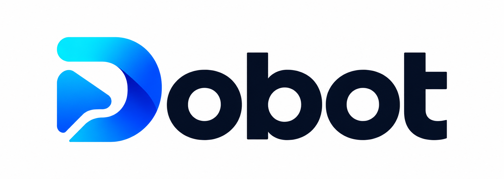
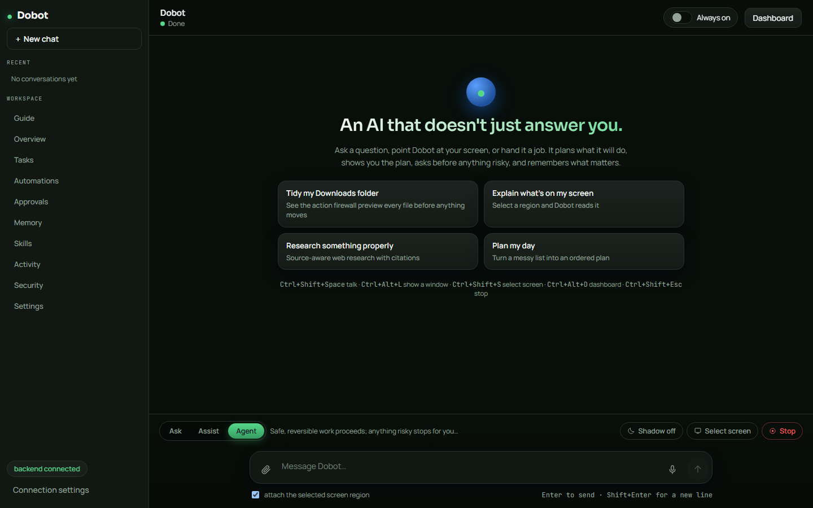
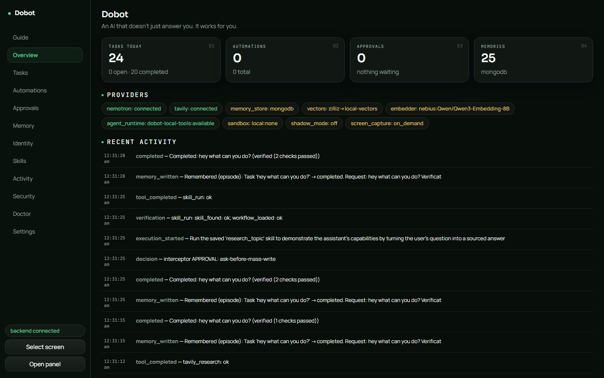
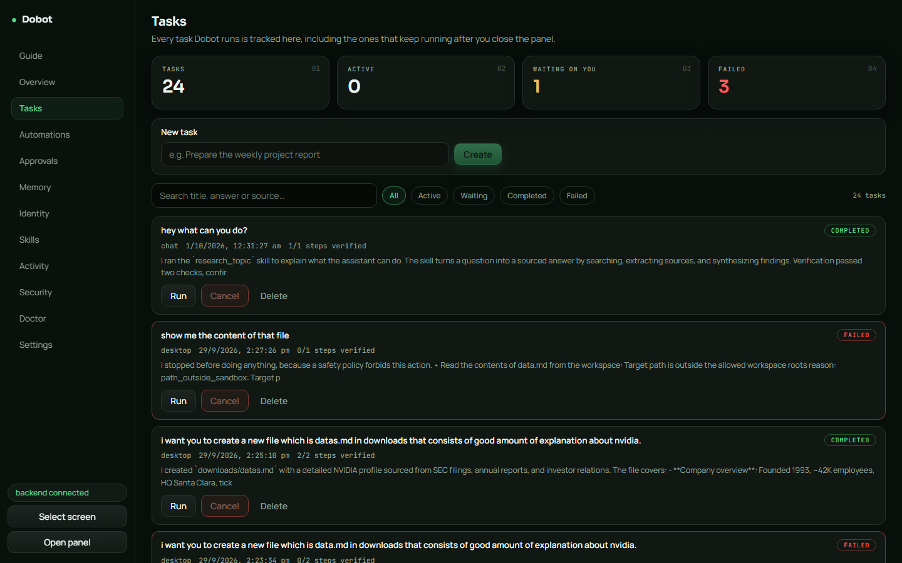
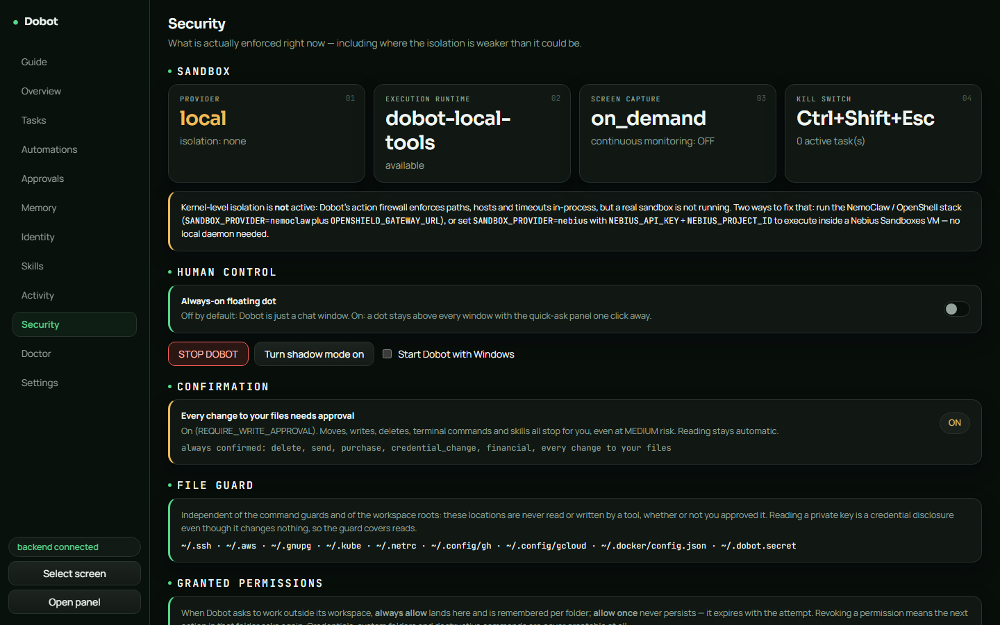
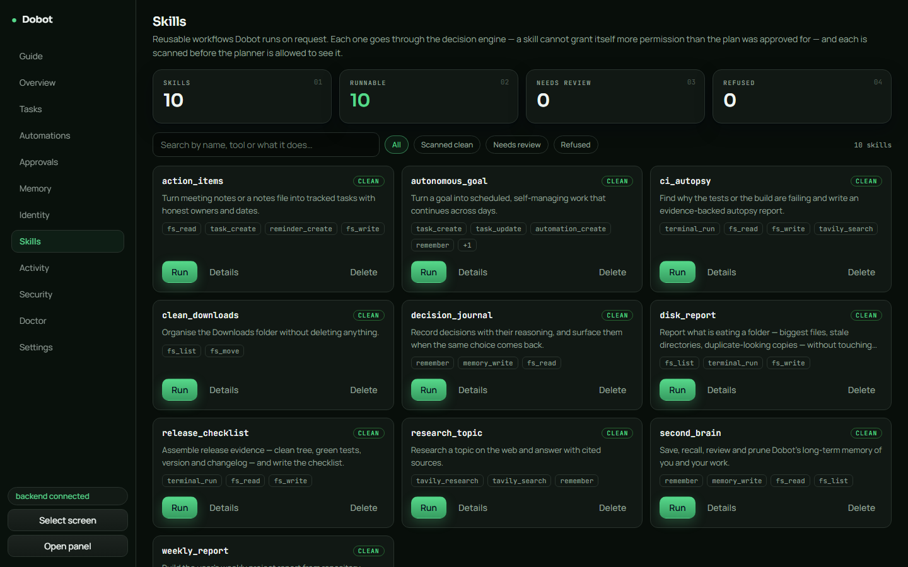
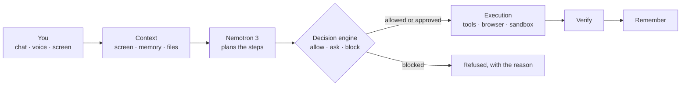

<div align="center">



# Dobot

**A personal AI that works on your computer — not just talks about it.**

It sees what you point at, plans the steps, asks before anything risky, does the work, checks that it worked, and remembers it for next time.




</div>

---

## Why Dobot

Most AI assistants make you do the work twice: you explain what you are looking at, read the answer,
then go and do it yourself. Dobot closes that loop.

```
  SEE  →  UNDERSTAND  →  DECIDE  →  ACT  →  VERIFY  →  REMEMBER
```

| | |
| --- | --- |
| **It does the work** | Moves files, runs commands, opens apps, drives a real browser, runs saved skills. |
| **Safety is code, not a prompt** | The AI only *suggests* actions. A fixed set of rules decides what may run, what needs your OK, and what is never allowed. |
| **It proves it** | Every step records how it was checked. If something could not be confirmed, Dobot says so instead of claiming success. |
| **Private by default** | The screen is captured only when you ask, speech is transcribed on your machine, and API keys never leave the backend. |
| **Works without keys** | With no API keys at all it still runs in a limited offline mode and tells you exactly what is missing. |

---

## What it can do

- **Answer and plan.** Simple questions get a direct answer; bigger requests become a step-by-step plan. Replies render formatted — headings, lists and code blocks, never raw markdown.
- **See your screen.** Select a region (`Ctrl+Shift+S`) or share the window you are in (`Ctrl+Alt+L`) and ask about it.
- **Listen.** Hold `Ctrl+Shift+Space`, speak, let go — or click the mic in the composer. Either way it is transcribed locally with Whisper.
- **Snip the screen.** Click the always-on dot and pick **Snip** — drag a box around any part of the screen and it lands in the chat, ready to ask about.
- **Talk out loud.** The same menu's **Voice** starts a live call: Dobot listens, answers and speaks, and you can interrupt an answer mid-sentence. Transcription stays on your machine.
- **Read your files.** Drop in images, logs or code files and ask about them — attachments open full size on click.
- **Research the web.** Flip the **Research** chip in the composer: Tavily search plus synthesis, answered with sources — no full agent loop needed.
- **Use your browser.** Opens a visible browser window and clicks, types and downloads like a person would.
- **Run skills.** Ten built-in workflows, such as *tidy downloads*, *weekly report*, *CI autopsy*, *release checklist* and *disk report*.
- **Remember.** Preferences, projects and past tasks come back as context later.
- **Automate.** Schedule recurring tasks and reminders.
- **Progress you can see.** Finished tasks and completed research earn XP: a level badge, a shimmering XP bar and a daily streak on Overview — completion pops confetti.
- **Updates itself.** New releases show an in-app banner and install from **Settings → Updates**, no `.exe` hunt.
- **Stop instantly.** `Ctrl+Shift+Esc` cancels whatever is running.

### You choose how much freedom it gets

| Mode | What happens |
| --- | --- |
| **Ask** | Answers and plans only. Nothing is executed. |
| **Assist** | Asks you before anything beyond reading. |
| **Agent** (default) | Safe, reversible work runs on its own; anything risky waits for you. |

### Two ways to use it

- **A normal chat window** (default) — conversations on the left, the chat on the right, and a **Workspace** picker in the sidebar for tasks, skills, memory, security and the rest.
- **The always-on dot** — turn on **Always on** and a small floating dot sits above every app. Its colour shows whether Dobot is thinking, working or waiting for you. A single click fans out a radial menu — **Chat**, **Snip** or **Voice** — a double click opens the quick-ask dialog straight away, and dragging the icon carries the open dialog with it, docked to its corner.

---

## A look inside

| Overview | Tasks |
| --- | --- |
|  |  |
| **Security** | **Skills** |
|  |  |

---

## How it works



1. **Context** — Dobot gathers what you shared, what it remembers and what is on screen.
2. **Plan** — Nemotron 3 turns your request into concrete steps.
3. **Decide** — each step is rated by risk and checked against the rules. This part is plain code; the AI cannot talk its way past it.
4. **Act** — allowed steps run; risky ones show an approval card first.
5. **Verify and remember** — results are checked, then saved to memory and the activity log.

More detail: [`docs/architecture.md`](docs/architecture.md).

---

## Safety at a glance

| Risk | Example | What Dobot does |
| --- | --- | --- |
| **Low** | Read a file, search the web | Runs |
| **Medium** | Create or move a file, run a terminal command | Runs in Agent mode; asks in Assist mode |
| **High** | Delete files, submit a form, install software | Always asks you first, with a preview |
| **Critical** | Payments, account-security changes, wiping a disk | Never runs automatically |

On top of that:

- **Approval cards show the real details** — file counts, sizes and destinations, not a vague "Allow?".
- **Folders outside the workspace** can be unlocked with **Allow once** or **Always allow**, and revoked later from the Security page.
- **Some things can never be unlocked** — credential folders like `~/.ssh` and `~/.aws` (not even for reading), system directories, destructive commands and disguised shell tricks.
- **Skills are scanned** for prompt injection, hidden credentials and dangerous commands before Dobot can use them.
- **Optional isolation** — run commands in NemoClaw / OpenShell or a Nebius cloud sandbox instead of directly on your PC.

Full details: [`docs/security.md`](docs/security.md).

---

## Built with

| Part | Technology |
| --- | --- |
| Reasoning | **NVIDIA Nemotron 3** via **Nebius Token Factory** |
| Web research | **Tavily** |
| Voice calls | **Silero VAD** for turn detection · local **Whisper** for speech · **Sarvam** bulbul TTS |
| Browser control | **Playwright** (built in) |
| Desktop control | **Hermes** agent runtime (optional) |
| Isolation | **NVIDIA NemoClaw / OpenShell** (optional) or the local action firewall |
| Risk signals | **AutoTrust JEV-27B-VL** decision model on Novita (optional, bring your own key) |
| Backend | Python · FastAPI · LangGraph |
| Desktop app | Tauri 2 · React · TypeScript |
| Memory | Local SQLite + local vector index |

<details>
<summary><b>Models in use</b></summary>

Dobot picks the cheapest model that can handle each request, so a simple "hello" never uses the largest one.

| Tier | Model | Used for |
| --- | --- | --- |
| Ultra | `nvidia/Nemotron-3-Ultra-550b-a55b` | Complex, multi-step work |
| Super | `nvidia/nemotron-3-super-120b-a12b` | Everyday requests that need a plan |
| Light | `nvidia/NVIDIA-Nemotron-3-Nano-30B-A3B` | Quick answers |
| Vision | `openbmb/MiniCPM-V-4_5` | Screenshots and images |
| Embedding | `Qwen/Qwen3-Embedding-8B` | Memory search |

Nemotron's "thinking" step is switched off for quick answers, so a simple question returns in about 3 seconds.
Set `NEMOTRON_ALWAYS_THINK=1` to keep it on everywhere.

</details>

---

## Quickstart

**You need:** Python 3.11+ with [uv](https://docs.astral.sh/uv/), Node 20+, and Rust 1.77+ (with WebView2 on Windows).

**1. Add your keys**

```bash
cp .env.example .env
```

Set `NEBIUS_API_KEY` (required for real answers) and `TAVILY_API_KEY` (for web research).
Optional: `SARVAM_API_KEY` (from sarvam.ai) gives the voice call its spoken replies — without it the
call still listens and answers in text.
You can also paste them later in the app under **Settings → Your API keys**.

Memory and chat history are stored locally in SQLite and the local vector index. `MULTI_USER=true`
can still enable local account isolation when needed.

**2. Start the backend**

```bash
cd backend
uv venv
uv pip install -e ".[dev]"
uv run uvicorn app.main:app --host 127.0.0.1 --port 8756
```

**3. Start the desktop app**

```bash
cd desktop
npm install
npm run tauri dev
```

**4. Try it**

1. *"Plan my day"* — a plan and an answer, nothing touched.
2. Press `Ctrl+Shift+S`, select something, then ask *"Explain what's on my screen"*.
3. In **Assist** mode: *"Tidy my Downloads folder"* — see the approval card before anything moves.

> **Want a real installer?** [`docs/install.md`](docs/install.md) covers building the `.exe`, running the
> backend in the background, hosting it on your own server, and uninstalling.

<details>
<summary><b>Run the tests</b></summary>

```bash
cd backend && uv run pytest -q          # 513 tests, no network needed
cd backend && uv run ruff check app tests
cd desktop && npm run build
```

</details>

---

## Hotkeys

| Keys | Action |
| --- | --- |
| `Ctrl+Shift+Space` | Hold to talk |
| `Ctrl+Alt+L` | Share the window you are in |
| `Ctrl+Shift+S` | Select part of the screen to ask about |
| `Ctrl+Alt+D` | Open the dashboard |
| `Ctrl+Shift+Esc` | **Stop everything** |

---

## Current limitations

Listed plainly, because pretending something works is worse than admitting it does not.

| Area | Today |
| --- | --- |
| **Desktop app control** | Clicking inside other desktop apps needs the real Hermes agent gateway (see [`docs/hermes.md`](docs/hermes.md)). Browser control works without it. For *your* desktop, point `HERMES_ENDPOINT` at a tunnel to the gateway running on your PC; when it is down, Dobot serves on its own tools and says which part is blocked. |
| **Browser logins** | Dobot uses its own browser profile, so you sign in once inside its window; existing Chrome logins do not carry over. |
| **Isolation** | By default commands run on your PC behind Dobot's own rules. Full sandboxing needs NemoClaw or a Nebius sandbox. |
| **Email and messages** | Dobot writes drafts but never sends anything. |
| **Voice** | Speech input — the talk chord, the mic button and a call's transcription — needs the ~484 MB Whisper model and ffmpeg on your machine. A call's *spoken* replies use Sarvam TTS, so they also need `SARVAM_API_KEY` in `.env`; without it the call listens and replies in text. |
| **Backend autostart** | The app does not start the backend for you by default — see [`docs/install.md`](docs/install.md). |
| **Multi-user** | Opt-in on the backend (`MULTI_USER=true` + `MONGO_URL`): accounts with invite codes, per-user memory/tasks/automations/API keys, per-user event streams. On a multi-user backend the desktop shell shows a sign-in / sign-up screen on its own and gates both windows until you're signed in; **Settings → Account** shows who you are and signs you out. See [`docs/security.md`](docs/security.md#accounts-and-multi-user-multi_usertrue). |
| **Updates** | Installed builds check GitHub Releases and show an in-app banner + **Settings → Updates** with one-click install. Maintainers publish a release by pushing a version tag (`.github/workflows/release-tauri.yml`). |

---

## Documentation

| Guide | What is inside |
| --- | --- |
| [Install](docs/install.md) | Build the installer, run the backend, host it, update and uninstall |
| [Prerequisites](docs/prerequisites.md) | Every setting in `.env`, and which ones you actually need |
| [Architecture](docs/architecture.md) | How the pieces fit together |
| [Security](docs/security.md) | Risk levels, approvals, sandboxes and what is not enforced |
| [Memory](docs/memory.md) | What Dobot remembers and how it recalls it |
| [Agent and skills](docs/agent.md) | Tools, runtimes and writing your own skills |
| [Hermes agent](docs/hermes.md) | The real Hermes gateway, its API contract, setup and verification |
| [Development](docs/development.md) | Setup, conventions, and the offline eval harness for contributors |
| [Screenshots](docs/screenshots/README.md) | Every page of the app |

---

<div align="center">

Licensed under [Apache 2.0](LICENSE)

</div>
